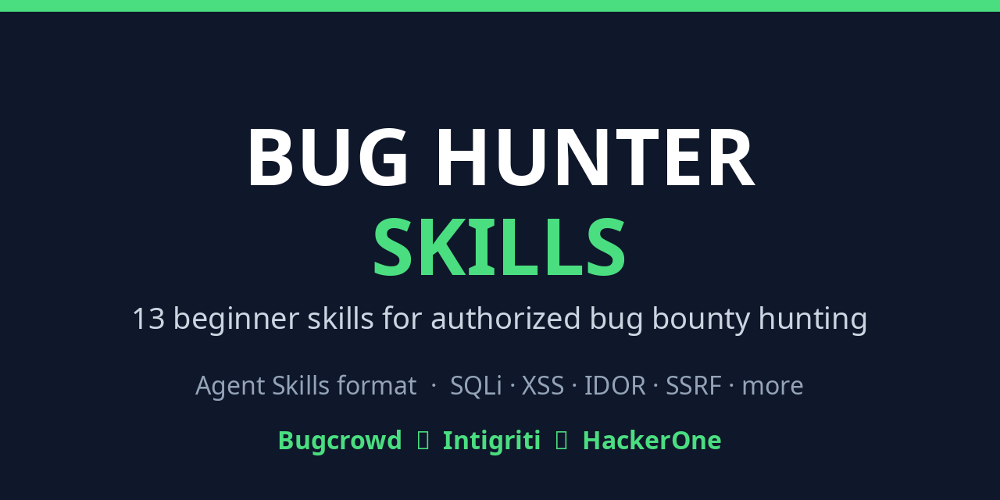

# Bug Hunter Skills



**Learn bug bounty hunting one bug class at a time.**

13 skills · 3 workflow commands · Bugcrowd + HackerOne report templates — an original, beginner-friendly bundle built in the open while learning the craft from zero.

## Quickstart

```bash
git clone https://github.com/red-xz/bug-hunter-skills.git
# copy skills/ into your AI coding agent's skills directory, e.g. ~/.claude/skills/
cp -r bug-hunter-skills/skills ~/.claude/skills/
```

The agent discovers skills by their frontmatter descriptions and loads the
relevant one when the task matches — e.g. "hunt for IDOR on this target"
loads `hunt-idor`. `commands/` and `templates/` are plain Markdown — paste
them into your agent's context or your own notes when you need the checklists.

> **Scope rule (applies to everything in this bundle):** only test targets that
> sit inside a published bug bounty program's scope with explicit authorization,
> or lab targets you own (OWASP Juice Shop, PortSwigger Academy, TryHackMe,
> HackTheBox). A vulnerability disclosure policy is NOT authorization. Never
> touch real user data, never exfiltrate, never run denial-of-service tests,
> never pivot beyond scope. If a finding gives you access to real data: stop,
> report, do not explore.

## Who this is for

A beginner bug bounty hunter working the classic path:

1. **Bugcrowd** first (beginner-friendly, managed triage, Payoneer payouts).
2. **Intigriti** second (EU programs, fast triage).
3. **HackerOne** long-term (largest, fiercest competition).

No prior hunting experience is assumed. Each skill explains the vulnerability in
plain language, where to look, how to test, how to confirm real impact, and how
to report it so triage can reproduce it.

## Skills (v1)

| Skill | What it covers |
|---|---|
| `bb-methodology` | The 5-phase hunt workflow: recon, mapping, testing, validation, reporting |
| `recon` | Passive recon inside scope: subdomains, tech fingerprinting, endpoints |
| `hunt-sqli` | SQL injection — detection, confirmation, impact |
| `hunt-xss` | Cross-site scripting — reflected, stored, DOM |
| `hunt-idor` | Broken access control / IDOR — the beginner's best first-win class |
| `hunt-auth` | Broken authentication and session issues |
| `hunt-ssrf` | Server-side request forgery |
| `hunt-open-redirect` | Open redirects |
| `hunt-csrf` | Cross-site request forgery |
| `hunt-info-disclosure` | Information disclosure — errors, files, metadata |
| `triage-validation` | Reproduce, confirm impact, check duplicates, set severity |
| `report-writing` | Bugcrowd + HackerOne report structure that triage accepts |
| `evidence-hygiene` | Screenshots, video, redacting PII, safe proof-of-concepts |

## Commands

Checklist-style workflow docs in `commands/`:

- `start-hunt.md` — scope check, recon, and first-pass testing for a new target
- `validate-finding.md` — confirm a candidate finding before reporting
- `write-report.md` — turn a validated finding into a submission-ready report

## Templates

Fill-in report templates in `templates/`:

- `bugcrowd-report.md` — Bugcrowd submission structure
- `hackerone-report.md` — HackerOne submission structure

## Learning path

`docs/learning-path.md` maps the skills onto a 30-day plan: Weeks 1–2 SQLi /
XSS / access control theory (PortSwigger Academy), Week 3 Juice Shop practice,
Week 4 the first real hunt on one public program.

## How to use with an AI coding agent

This bundle follows the [Agent Skills open standard](https://agentskills.io):
each skill is a `skills/<name>/SKILL.md` file with frontmatter (`name`,
`description`). Copy the `skills/` folder into your agent's skills directory
(for example `~/.claude/skills/` for Claude Code, or your agent's equivalent)
and the agent loads the right skill for the task.

## Beginner path (the honest version)

- First payout realistically takes 1–3 months. First bounties are usually
  $50–500, not the headline numbers.
- One verified, reproducible finding beats ten guesses. Platforms in 2026 are
  flooded with low-quality reports; clean reproduction steps + real impact are
  what get paid.
- Valid reports earn private program invitations — better pay, less
  competition. That is the compounding path.

## Contributing

Beginners welcome — see [CONTRIBUTING.md](CONTRIBUTING.md). Small, well-scoped
tasks are listed in [GOOD-FIRST-ISSUES.md](GOOD-FIRST-ISSUES.md).

## v2 roadmap

More vulnerability classes as the hunter learns them: XXE, SSTI, business
logic flaws, race conditions, OAuth/account-takeover flows, API testing
(BOLA / mass assignment), file upload flaws, and subdomain takeover.
Program-specific notes (Bugcrowd VRT, HackerOne severity ratings) will be added
as real reports come back from triage.

## License

MIT — see `LICENSE`.

---

If this helps your hunting, star it ⭐ — it helps other beginners find it.
